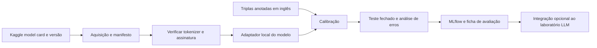

# 08 — Reuso de modelo pré-treinado do Kaggle

**Estado demonstrado:** Planejado · standby. Evidências de 28/10/2026 quando aplicável.

Este documento preserva requisitos e design do estudo. Etapas futuras, quantidades planejadas e critérios de aceite não comprovam execução. Consulte o estudo de caso para escopo, resultados e limites atuais.

**Estado:** planejado; nenhum peso/modelo foi baixado ou executado. **Competência:** selecionar, versionar, integrar e avaliar um artefato treinado por terceiros. **Dependência:** acesso ao artefato, licença e runtime TensorFlow em CPU compatível. Pode usar dataset sintético próprio e independe do treino do projeto 07.

## Modelo escolhido e objetivo

**Candidato definido:** Google BERT Answer Equivalence BEM, handle versionado `google/bert/tensorFlow2/answer-equivalence-bem/1`, publicado em [Kaggle Models](https://www.kaggle.com/models/google/bert). O model card apresenta um modelo de equivalência de respostas, licença Apache 2.0 e saída em logits. Acesso e conteúdo da versão deverão ser reconfirmados na aquisição.

Objetivo: verificar se uma resposta candidata preserva o significado da resposta de referência para a mesma pergunta. Ele será um **avaliador**, não um modelo gerador de respostas nem verificador completo de factualidade/autorização.

O primeiro benchmark será em inglês. Não presumir qualidade em português; o projeto 04 continua avaliando PT-BR com suas próprias métricas. Extensão futura de português requer um conjunto anotado separado e conclusão limitada ao que foi medido.

## Requisitos

| ID | Requisito | Critério de aceite futuro |
| --- | --- | --- |
| RF01 | Preservar a origem do modelo | Handle/versão, hashes, licença e model card no manifesto |
| RF02 | Empacotar preprocessamento correto | Tokenizer, ordem dos campos e limites correspondem ao modelo |
| RF03 | Produzir score reproduzível | Mesmo trio pergunta/referência/candidata gera saída equivalente dentro da tolerância medida |
| RF04 | Calibrar a decisão no domínio | Limiar escolhido só no conjunto de calibração |
| RF05 | Comparar com baseline simples | Exact match e token-F1 no mesmo benchmark |
| RF06 | Medir falhas importantes | Negação, números, entidades, resposta parcial e truncamento |
| RF07 | Integrar como avaliador opcional | Saída com score, versão, status e aviso de limite |
| RNF01 | Operar em CPU e amostra pequena | Sem fine-tuning ou GPU obrigatórios |
| RNF02 | Dar atribuição correta | Resultado distingue modelo de terceiro e adaptação própria |

## Pipeline de artefato e benchmark

Aquisição planejada: `kagglehub.model_download` com o handle de versão completa. Conservar os arquivos em Volume permitido, com manifesto; cache não é a cópia persistente. Se a rede impedir, importar manualmente o artefato permitido para o Databricks. Não executar notebooks/código arbitrário de terceiros como parte da aquisição.

A etapa de compatibilidade deve identificar o SavedModel, seu callable/signature, entradas, ordem do texto, tokenização, vocabulário, special tokens e tamanho máximo. Usar o exemplo e as especificações do model card; não substituir pelo tokenizer genérico de outro BERT só por ter o mesmo nome. Não inventar que arquivos de tokenizer estão dentro do pacote: conferir e manifestar dependências auxiliares.

O adaptador recebe `question`, `reference_answer`, `candidate_answer`; retorna `equivalence_score`, `decision`, `model_handle`, `model_version`, `preprocessor_version`, `truncated`, `error_type`. Aplicar a transformação de logits recomendada pelo modelo; o score não é uma probabilidade calibrada no domínio até ser avaliado como tal.

## Bibliotecas e ambiente

| Lib/componente | Finalidade |
| --- | --- |
| `kagglehub` | Aquisição versionada do modelo |
| `tensorflow` compatível com CPU | Carregamento/execução do SavedModel |
| `tensorflow-hub` | Loader candidato conforme o model card; validar compatibilidade com TensorFlow/Keras |
| Tokenizer requerido pelo modelo | Implementação e vocabulário definidos após inspecionar os artefatos oficiais |
| `numpy`, `scipy` | Pós-processamento e análise dos scores |
| `scikit-learn` | Métricas de classificação e calibração de limiar |
| `pandas`, `matplotlib` | Resultados e curvas |
| `pydantic` | Contratos de entrada/saída |
| MLflow Tracking / pyfunc opcional | Experimentos e empacotamento do adaptador após compatibilidade |

Não instalar TensorFlow no mesmo ambiente de todas as trilhas por padrão. Definir um ambiente de notebook específico, com versões fixadas após o primeiro smoke test. TFHub/SavedModel e Keras podem ter requisitos diferentes entre versões; se a conta não permitir a combinação necessária, registrar impedimento e manter a integração pendente.

## Dataset, splits e experimentos

Criar 120 triplas sintéticas em inglês: pergunta, resposta de referência e candidata. Balancear equivalentes/não equivalentes e incluir paráfrase correta, alteração de número, negação, troca de entidade, omissão importante e linguagem fora do domínio. Dois rótulos: equivalência binária e tipo de perturbação. Revisão manual com critérios documentados.

Divisão por grupo de pergunta: 40 desenvolvimento, 40 calibração e 40 teste. Paráfrases/variantes da mesma pergunta ficam no mesmo split. Para estimar precisão de uso fora do benchmark balanceado, criar no futuro uma amostra com prevalência real; a precisão do conjunto sintético não se transfere automaticamente.

Experimento: `.../08_modelo_kaggle_avaliador/experimentos/equivalencia_respostas`.

| ID | Comparação | Hipótese |
| --- | --- | --- |
| K01 | Exact match × token-F1 × BEM | Reuso de modelo reconhece paráfrases além de sobreposição textual |
| K02 | Limiares definidos na calibração | Reduzir falsos equivalentes em números/negações |
| K03 | Textos curtos × próximos do limite | Quantificar impacto de truncamento |
| K04 | CPU batches 1 × 8, se couber | Aumentar throughput sem alterar a decisão |

Registrar handle/versão/hash, preprocessor, ambiente, batch size e limiar. Métricas: precisão/recall/F1 de equivalência, falsos equivalentes por perturbação, ROC-AUC/PR-AUC quando apropriadas, latência e memória quando mensurável. Artefatos: manifesto, model card atribuído, benchmark/gabarito, matriz de confusão, curvas e casos de erro.

Limites iniciais: até 3 limiares na calibração, uma avaliação final de teste e até 2 tamanhos de batch. Não retreinar nem fine-tunar nesta versão. O custo principal é download/CPU; medir duração e espaço real antes de ampliar.

## Seleção, integração e validação

Meta proposta: priorizar precisão de equivalência de pelo menos 0,90 na calibração e zero falsos equivalentes nos casos críticos conhecidos de alteração numérica/negação. Avaliar a meta no teste e reportar contagens/intervalos; não garantir desempenho com uma amostra pequena. Se não passar, usar o score apenas como sinal auxiliar e manter decisão humana/determinística.

Testes futuros: pergunta vazia, texto longo, Unicode, troca da ordem reference/candidate, alteração de número, negação, tokenizer ausente, arquivo incompleto e recarga do artefato. Truncamento deve aparecer no resultado e pode exigir revisão, não aprovação silenciosa.

Empacotamento opcional após validação: modelo `workspace.estudos_ai.avaliador_bem` com adapter pyfunc, signature, input example, artefatos e dependências. O registro não altera a autoria dos pesos. Na integração ao 04, usar apenas subset inglês, guardar o score lado a lado com rubrica humana e checks de citação/escopo.

## Fases, entregas e demonstração

1. Model card/licença e manifesto de aquisição.
2. Compatibilidade CPU, tokenizer e contrato de inferência.
3. Benchmark em inglês com gabarito e splits.
4. Baselines, calibração, teste e análise de falhas.
5. Adaptador versionado e integração opcional ao projeto 04.

Notebooks planejados: `01_fonte_modelo`, `02_compatibilidade`, `03_benchmark`, `04_experimentos`, `05_integracao`. Entregáveis: ficha do modelo de terceiros, adapter design, ambiente fixado, relatório de avaliação e release preservada.

**Demonstração:** abrir a origem do modelo no Kaggle, identificar a versão usada, comparar uma paráfrase correta e uma resposta com número/negação alterados, mostrar os escores e explicar uma falha. Deixar claro o que veio pronto e qual foi a contribuição própria: integração, dados de avaliação, testes e análise.

Riscos/decisões abertas: dependências de tokenizer, licença de artefatos auxiliares, runtime CPU, downloads e desempenho no domínio. Nenhum deles é considerado validado só porque o modelo está publicado.

Referências: [model card Google BERT/BEM no Kaggle](https://www.kaggle.com/models/google/bert), [KaggleHub oficial](https://github.com/Kaggle/kagglehub), [Kaggle Models](https://www.kaggle.com/docs/models) e [Model Registry UC](https://docs.databricks.com/aws/en/machine-learning/manage-model-lifecycle/).
